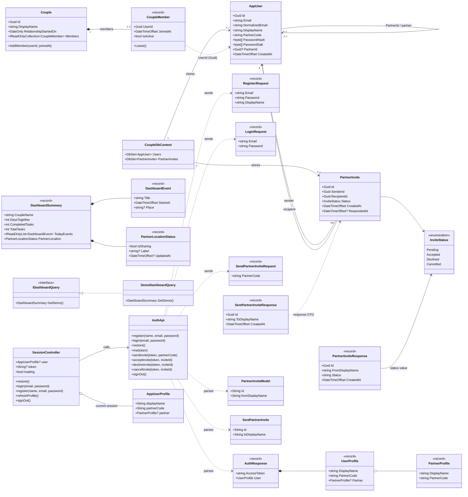
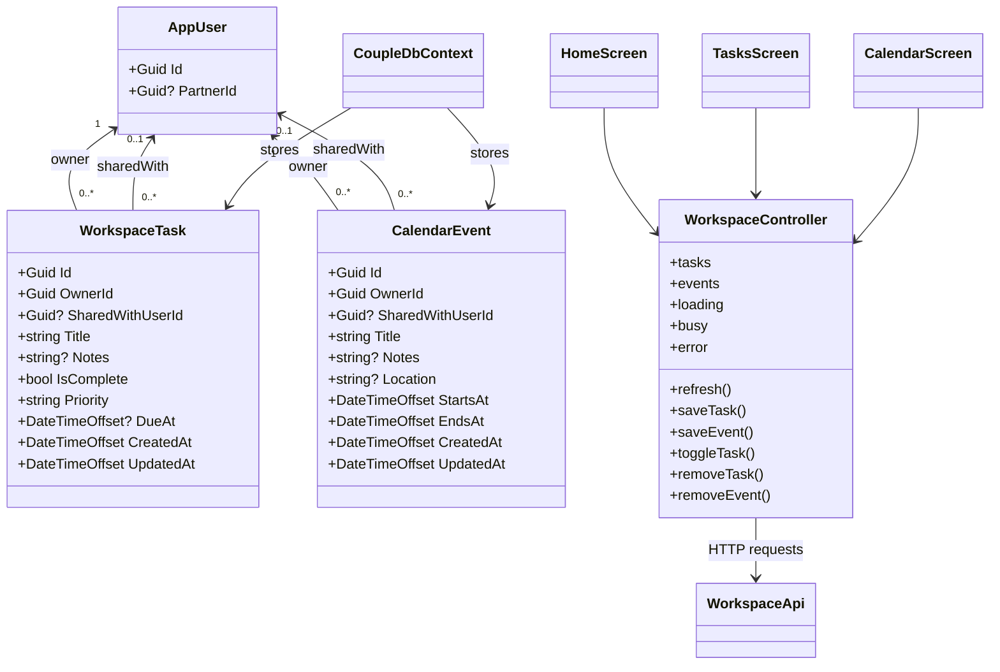

# Couple App — Class Diagram

Sơ đồ dưới đây mô tả lớp tài khoản/kết nối trong backend và Flutter client. `AppUser` và `PartnerInvite` được lưu bằng Entity Framework Core; `Couple`/`CoupleMember` là domain model độc lập. Phần việc và lịch được bổ sung trong sơ đồ riêng phía dưới. `DemoDashboardQuery` trong sơ đồ cũ còn tồn tại trong source nhưng không còn phục vụ endpoint trang chủ.

Lưu ý: domain `Couple`/`CoupleMember` chưa được map vào `CoupleDbContext`. `Members` có thể chứa nhiều thành viên lịch sử, với tối đa hai thành viên đang hoạt động; giới hạn `0..2` ở trên chỉ mô tả thành viên đang hoạt động. Chia sẻ vị trí vẫn chưa được triển khai.

## Workspace — bổ sung tháng 11/2026

`sharedWith` chỉ có hiệu lực khi hai tài khoản vẫn đang kết nối hai chiều. Model
Flutter ánh xạ các response tương ứng; `createdByMe` do server tính để giao diện
chỉ cho người tạo thay đổi chế độ chia sẻ.
